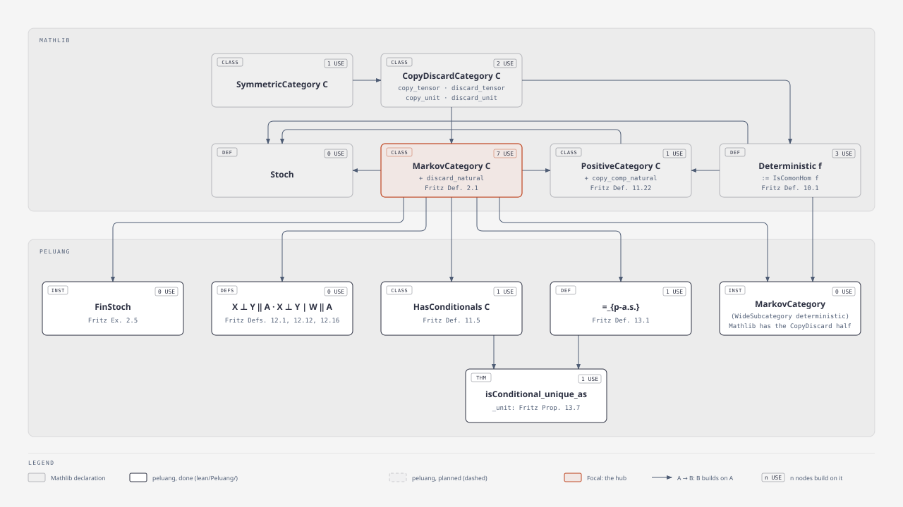
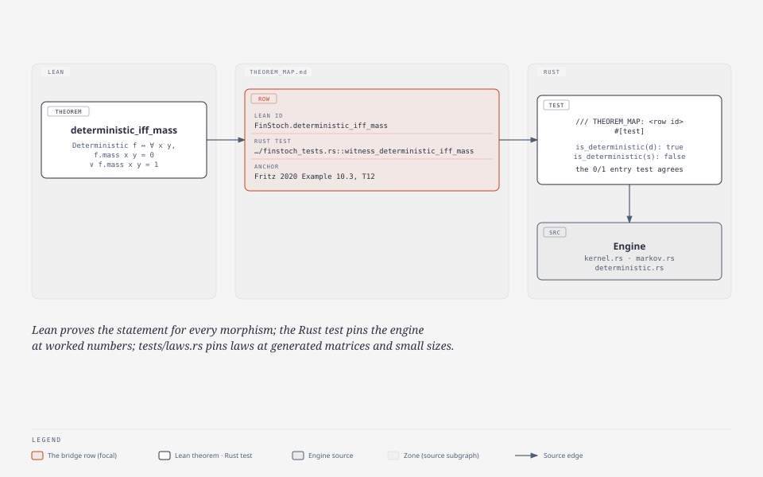

# peluang

Categorical probability with proofs: a Lean 4 library over Mathlib's
`MarkovCategory` and a Rust crate that computes the same structures on finite
stochastic kernels. `THEOREM_MAP.md` is the bridge: each Lean theorem has a Rust
witness test or a stated opt-out.

Anchor of record: T. Fritz, *A synthetic approach to Markov kernels,
conditional independence and theorems on sufficient statistics*,
arXiv:1908.07021. Citations use definition and theorem numbers.

## Results

Release `v0.5.8` proves these statements under `lean/Peluang/`. The proofs have
no `sorry`, and they use only the axioms `propext`, `Classical.choice` and
`Quot.sound`.

- `instance : MarkovCategory FinStoch`: finite sets and stochastic matrices with
  entries in `ℚ≥0` form a Markov category (Fritz 2020 Example 2.5).
- The deterministic morphisms of FinStoch are the functions (Example 10.3). The
  fair Bernoulli state is not deterministic.
- In a Markov category, the deterministic morphisms form a wide subcategory that
  is again a Markov category (Remark 10.13). This instance has no
  `THEOREM_MAP.md` row.
- In a copy-discard category, almost-sure equality with respect to `p : A ⟶ X`
  is an equivalence relation on `X ⟶ Y`, kept by postcomposition (Def. 13.1,
  Lemma 13.4). Two pairs of almost surely equal morphisms give equal composites
  after copying `X` into three outputs (Lemma 13.5). In FinStoch, almost-sure
  equality is equality of the rows that `p` reaches (Example 13.2).
- `instance : HasConditionals FinStoch`: the computable `FinStoch.cond` is a
  conditional of every morphism into a tensor product, with the uniform
  distribution on rows of zero mass (Def. 11.5, Example 11.6). Conditionals in
  FinStoch are not unique: one morphism has two distinct conditionals
  (Prop. 11.15).
- In a copy-discard category, two conditionals of `f : A ⟶ X ⊗ Y` are almost
  surely equal with respect to `Δ[A] ≫ (marginalFst f ▷ A)`. At `A = I`, two
  conditionals `X ⟶ Y` of `ψ : I ⟶ X ⊗ Y` are almost surely equal with respect
  to the marginal of `ψ` (Prop. 13.7).
- The rewrite rules of conditionals: nesting (Lemma 11.11) and pre-composition
  by a deterministic morphism (the Café post's third rule, Def. 10.1) in a
  copy-discard category, and post-composition (Lemma 11.12) in a Markov
  category. In FinStoch, pre-composition by the fair coin does not preserve a
  conditional.
- Independence `X ⊥ Y ‖ A` (Def. 12.12), conditional independence
  `X ⊥ Y | W ‖ A` (Def. 12.16) and its output form (Def. 12.1), in a
  copy-discard category. In a Markov category, `f` displays independence iff
  `f = Δ[A] ≫ (g ⊗ₘ h)` for some `g`, `h` (Lemma 12.11), and Def. 12.16 at
  `W = I` is Def. 12.12. In a copy-discard category, independence is the Café
  post's conditional form D19, and Def. 12.16 at `A = I` is Def. 12.1. In
  FinStoch, the copied fair coin does not display independence.
- In a copy-discard category, `g : Y ⟶ X` is a Bayesian inverse of `f : X ⟶ Y`
  with respect to `p : A ⟶ X` when
  `p ≫ Δ[X] ≫ (X ◁ f) = (p ≫ f) ≫ Δ[Y] ≫ (g ▷ Y)` (Remark 13.10, equation
  (13.2); Cho–Jacobs, arXiv:1709.00322, equation (5)). Two Bayesian inverses
  are almost surely equal with respect to `p ≫ f`. The predicate holds for
  identities. Composition, tensor products and almost-sure equality keep it.
  For a state `p`, it is equivalent to a conditional of `p ≫ Δ[X] ≫ (f ▷ X)`.
  A category with conditionals then has a Bayesian inverse of every `f`. In a
  Markov category, `p ≫ f ≫ g = p`, and `f` is a Bayesian inverse of `g` with
  respect to `p ≫ f`.
- `FinStoch.bayesInv p f` is a Bayesian inverse of `f` with respect to a state
  `p` (Cho–Jacobs Example 3.8). Bayesian inverses in FinStoch are not unique:
  one morphism has two distinct Bayesian inverses.
- In a copy-discard category, `f : X ⟶ Y` is `p`-almost surely deterministic
  when `f ≫ Δ[Y]` and `Δ[X] ≫ (f ⊗ₘ f)` are `p`-almost surely equal
  (Def. 13.11). A deterministic morphism has this property. Almost-sure
  equality (Lemma 13.12) and postcomposition with a deterministic morphism
  keep it. In FinStoch, it holds iff each row of `f` that `p` reaches has only
  the entries `0` and `1`. One such morphism is not deterministic.
- `CausalCategory` is a Markov category with the causality axiom (Def. 11.31).
  In it, `(f ≫ g)`-almost surely equal `h₁` and `h₂` give `f`-almost surely
  equal `g ≫ h₁` and `g ≫ h₂`. A `p`-almost surely deterministic `f` and a
  `(p ≫ f)`-almost surely deterministic `g` have a `p`-almost surely
  deterministic composite (Remark 13.14). A Markov category with conditionals
  is causal (Prop. 11.34).
- `RelativelyPositiveCategory` is a Markov category with the almost-sure form
  of the positivity axiom (Def. 13.16; arXiv:2211.02507, equation (78)). Every
  causal Markov category is relatively positive (arXiv:2211.02507,
  Corollary 2.28). Every relatively positive Markov category is a Mathlib
  `PositiveCategory` (Remark 2.27 of that paper; Def. 11.22). In a relatively
  positive Markov category, a `p`-almost surely deterministic `f ≫ g` has a
  `(p ≫ f)`-almost surely deterministic `g` (Remark 13.17 (b)).
- A Markov category in which every morphism is deterministic is cartesian
  monoidal (Heunen–Vicary, *Categories for Quantum Theory*, Theorem 4.28). The
  deterministic morphisms of a Markov category form such a category
  (Remark 10.13). These two definitions have no `THEOREM_MAP.md` row.
- `instance : CausalCategory FinStoch`. Instance search then gives
  `RelativelyPositiveCategory FinStoch` and `PositiveCategory FinStoch`. In
  FinStoch, one deterministic composite has a first factor that is not
  deterministic. The hypothesis of causality holds there for two distinct
  morphisms `h₁` and `h₂`.
- In a copy-discard category, the tensor product of a `p`-almost surely equal
  pair and a `q`-almost surely equal pair is `(p ⊗ₘ q)`-almost surely equal
  (the sentence after Lemma 13.5).
- For a monoidal category `C`, the category `Under (𝟙_ C)` of states is
  monoidal, with `(X, ψ) ⊗ (Y, φ) = (X ⊗ Y, (λ_ (𝟙_ C)).inv ≫ (ψ ⊗ₘ φ))`. It is
  braided or symmetric when `C` is. A quotient of a monoidal category by a
  relation that is stable under whiskering is monoidal, and braided or
  symmetric when the category is. These instances have no `THEOREM_MAP.md` row.
- `ProbStoch C` is the quotient of `Under (𝟙_ C)` by almost-sure equality with
  respect to the state of the domain, for a causal Markov category `C`
  (Def. 13.8). The relation is a congruence, and two morphisms of states have
  one image iff they are almost surely equal. Instance search gives the
  symmetric monoidal structure of `ProbStoch C`, and the quotient functor
  keeps `⊗ₘ` (Prop. 13.9 (a)).
- In a causal Markov category with conditionals, `ProbStoch.dagger` sends the
  class of `f` to the class of each Bayesian inverse of `f` (Remark 13.10). It
  keeps identities, reverses composition and is an involution (footnote 28).
  `ProbStoch.homEquivCoupling` is a bijection from the morphisms
  `(X, ψ) ⟶ (Y, φ)` of `ProbStoch C` to the morphisms `𝟙_ C ⟶ X ⊗ Y` with
  marginals `ψ` and `φ`. It sends the class of `f` to `ψ ≫ Δ[X] ≫ (X ◁ f)`
  (Prop. 13.9 (b), first step of the proof). The category of couplings of
  Remark 12.10 is not stated.
- In FinStoch, two distinct morphisms of states have one image in
  `ProbStoch FinStoch`, and two morphisms of states have distinct images.
- Eight named isomorphisms reorder the factors of a tensor product: one in a
  monoidal category and seven in a braided monoidal category. Each has a
  theorem that gives its `hom` as a composite of associators, braidings and
  their whiskerings; the one of the monoidal category has no braiding.
  `tensorRev₃ X W Y : X ⊗ (W ⊗ Y) ≅ Y ⊗ (W ⊗ X)` is natural in `X`, `W` and
  `Y`. `tensorTripleInterchange X₁ W₁ Y₁ X₂ W₂ Y₂` is natural in its six
  objects.
- In a copy-discard category, `IsConditionalSnd f g` says that
  `g : Y ⊗ A ⟶ X` is a conditional of `f : A ⟶ X ⊗ Y` on `Y` (Def. 11.5). It
  holds iff `f` equals
  `Δ[A] ≫ (A ◁ (marginalSnd f ≫ Δ[Y])) ≫ (α_ A Y Y).inv ≫ ((β_ A Y).hom ▷ Y) ≫ (g ▷ Y)`.
  A category with conditionals has such a `g` for every `f`.
- In a copy-discard category, `DisplaysIndep` has symmetry and decomposition
  (Lemma 12.13): it is stable under the braiding of the two outputs, and
  under the marginal that drops `X₂` from `f : A ⟶ (X₁ ⊗ X₂) ⊗ Y`.
- `DisplaysCondIndepState` has the four semigraphoid properties (Lemma 12.5).
  Symmetry and decomposition hold in a copy-discard category. Weak union
  holds in a copy-discard category with conditionals. Contraction holds in a
  Markov category.
- `DisplaysCondIndep` has the four semigraphoid properties (Prop. 12.17), for
  a morphism `f` with an input `A`. Symmetry and decomposition hold in a
  copy-discard category. Decomposition drops `X₂` from
  `f : A ⟶ (X₁ ⊗ X₂) ⊗ (W ⊗ Y)`. Weak union holds in a copy-discard category
  with conditionals. Contraction holds in a Markov category.
- `DisplaysCondIndep` has the composition properties of Prop. 12.18. In a
  copy-discard category, it holds for the tensor product of two morphisms
  that display it, after `tensorTripleInterchange` (a). It holds for
  `f ≫ X₁ ◁ ((Δ[V] ≫ V ◁ g) ▷ Y₁)` after `tensorCompReorder`, for
  `f : A ⟶ X₁ ⊗ (V ⊗ Y₁)` and `g : V ⟶ X₂ ⊗ (W ⊗ Y₂)` that display it (b). For
  `f : A ⟶ X₁ ⊗ (W ⊗ Y₁)` that displays it, it holds for the composite of `f`
  with each `u : A ⊗ X₁ ⟶ X₂` and `v : Y₁ ⊗ A ⟶ Y₂` (c). In a Markov category
  with conditionals, for `f : A ⟶ X ⊗ ((V ⊗ W) ⊗ Y)` that displays it,
  `f ≫ (tensorCondReorder X V W Y).hom` has a conditional on `V` that displays
  it (d). In a Markov category, each conditional `g'` of `g : A ⟶ V ⊗ W` on
  `V` gives a conditional of
  `condIndepForm g h k ≫ (tensorCondReorder X V W Y).hom` on `V`: a
  `condIndepForm` with first factor `g'`.

At `v0.5.8`, `THEOREM_MAP.md` has 109 rows that pair a Lean id with a Rust test.
The crate has 284 tests with all features on.

[](docs/diagrams/lean-1-classes.svg)

[](docs/diagrams/lean-4-bridge.svg)

## Architecture

- `src/`:
  - `prob.rs`: the `Prob` carrier trait and `sum`. Exact rationals are the
    default, and `f64` is behind the `f64-prob` feature.
  - `finset.rs`: finite objects, with `tensor` as concatenation of factors.
  - `kernel.rs`: `Kernel<P>`, a stochastic matrix. `Kernel::new` tests its input.
  - `markov.rs`: `Compose`, `Tensor`, the structure maps and the marginals.
  - `deterministic.rs`: `is_deterministic` and `is_as_deterministic`.
  - `almost_sure.rs`: `as_equal`.
  - `conditional.rs`: `conditional` and `conditional_snd`.
  - `bayes.rs`: `bayesian_inverse` and `is_bayesian_inverse`.
  - `independence.rs`: `is_independent`, `cond_indep_form` and
    `is_cond_independent_state`.
  - `information_flow.rs`: `copy_then`, `copy_comp_natural` and
    `copy_comp_natural_as`.
  - `prob_space.rs`: `is_state_preserving` and `coupling`.
  - `exec.rs` (behind `async`) and `error.rs`.
- `lean/`: the Lake project (`Peluang`), pinned by `lean/lean-toolchain`,
  `lean/lakefile.lean` and `lean/lake-manifest.json`; `lean/Peluang.lean` is
  the library root and imports every file under `lean/Peluang/`.
- `tests/formalization_lean/`: witness tests tagged `/// THEOREM_MAP: <id>`.
- `tests/laws.rs`: law tests on `proptest` kernels and on each cardinality
  from 0 to 4.
- `THEOREM_MAP.md`: Lean theorem → Rust test → anchor.
- `scripts/check_theorem_map.py`: every theorem of the library has a
  `THEOREM_MAP.md` row with an existing witness, or a `-- WITNESS: none`
  opt-out.
- `scripts/print_axioms.py`: the axioms of every constant defined in the
  `Peluang` library, allowlist `{propext, Classical.choice, Quot.sound}`,
  and the Lean id of each `THEOREM_MAP.md` row without the `mathlib:`
  prefix, which must name a constant of the library.
- `scripts/probe_selftest.py`: `print_axioms.py` against a planted module
  of `sorry` and `native_decide` constants.
- `scripts/check_lean_source.py`: `sorry`/`admit` terms and `axiom`
  declarations in `lean/` sources, outside comments and literals.
- `lean/PeluangLint.lean`: build-time linter for `lean/PeluangTest`. In a
  `PeluangTest` module that imports it, an example with an axiom outside
  the allowlist is a build error. A command that adds a constant is also
  a build error. A hidden
  constant without an `_example` name component, such as the auxiliary
  definition of `#eval`, is also a build error.
  `lean/PeluangTest/Audit.lean` runs `#peluang_test_audit`. It reports a
  test file that is not imported or does not import the linter. It also
  reports a test module with a constant or with entries outside four
  allowed environment extensions. The plants under
  `lean/PeluangTest/Plant/` hold these errors under `#guard_msgs`, and
  the audit allows their constants and entries.

## Features

All off by default.

- `f64-prob` — `Prob` for `f64` with a declared tolerance. Witness tests use
  `Exact` weights and also run in this lane.
- `parallel` — `prob::sum` runs on rayon (via `rayon-cond`) at or above
  `prob::PAR_THRESHOLD` terms. On a target with threads, it uses the rayon
  pool of the calling thread: the `exec::Executor` pool inside
  `Executor::run`, the global pool on a thread outside any rayon pool. On
  such a thread, the caller blocks until the workers finish and then runs the
  last combining `add`. `compose`, `marginal_fst`, `marginal_snd` and
  `marginal` compute each weight through `prob::sum`.
- `async` — implies `parallel`; `exec::Executor` owns a rayon pool and
  `Executor::run` awaits a closure on it (`tokio-rayon`). The crate creates
  no async runtime.

## WebAssembly

WASI first: `wasm32-wasip1-threads` with `parallel`/`async`,
`wasm32-wasip1` without them; `wasm32-unknown-unknown` builds the library
with default features. Browsers are out of scope. CI checks these with
`cargo check --lib`.

## Requirements

- Rust per `rust-toolchain.toml`; `cargo-nextest` recommended.
- Lean 4 via `elan`; the toolchain is read from `lean/lean-toolchain`.
- Python 3.12+ for the scripts.

## Test

```sh
# Rust
cargo nextest run
cargo nextest run --features f64-prob
cargo nextest run --features parallel
cargo nextest run --features async
cargo nextest run --all-features
# scripts and bridge (no Lean needed)
python3 -I scripts/test_check_theorem_map.py
python3 -I scripts/test_print_axioms.py
python3 -I scripts/test_check_lean_source.py
python3 -I scripts/test_probe_selftest.py
python3 -I scripts/check_lean_source.py
python3 -I scripts/check_theorem_map.py
# Lean (every lake command runs with lean/ as the working directory)
env -C lean lake exe cache get
env -C lean lake build --no-build Mathlib
rm -f lean/.lake/build/lib/lean/PeluangTest/Audit.trace
env -C lean lake build > /tmp/lake-build.log 2>&1
rg -c 'peluangTest audit: [0-9]+ files' /tmp/lake-build.log   # must print 1
python3 -I scripts/print_axioms.py
python3 -I scripts/probe_selftest.py
```

## Examples

`examples/weather_sprinkler.rs` builds the running example on `Exact`
weights through the public API: the temperature state `psi_t : I → T`, the
weather kernel `c : T → W` and the sprinkler kernel `s : W → S`. It prints
the weather state, the sprinkler state, the joint state on `W ⊗ S` and its
two marginals. It returns an error when a marginal differs from its
composite. CI runs it.

```sh
cargo run --example weather_sprinkler
```

## Documentation

`cargo doc --no-deps --open`. The Lean library's statements are the
specification; `THEOREM_MAP.md` says which test pins which theorem.

## Acknowledgments

Trait shapes adapted from [`sustia-llc/catgraph`](https://github.com/sustia-llc/catgraph)
(MIT); see `THIRD-PARTY.md`. Mathlib's `CopyDiscardCategory`,
`MarkovCategory`, `PositiveCategory` and `Stoch` are the foundation the Lean
library builds on.

## License

MIT — see `LICENSE`.
